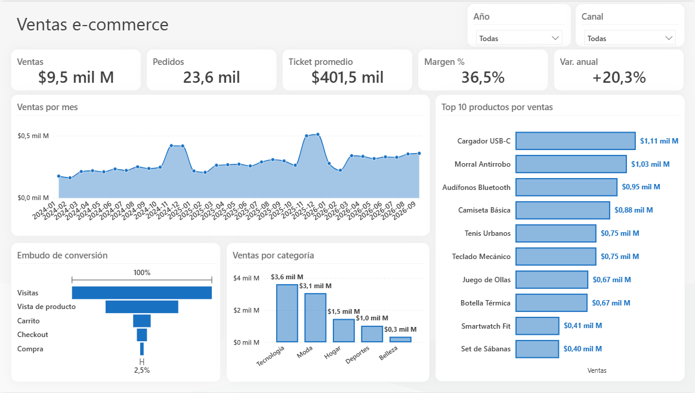
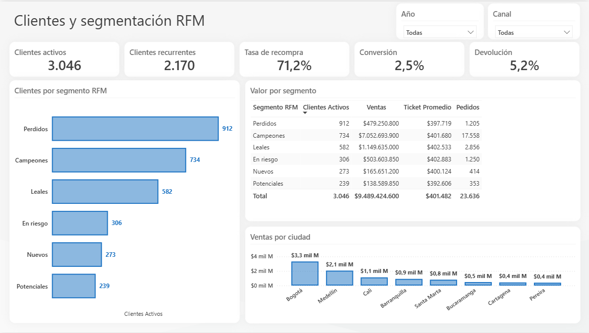

# Dashboard de ventas y clientes e-commerce (Power BI)

Tablero para responder tres preguntas de una tienda online: cuánto vendemos, dónde se pierden los compradores y qué clientes valen más.

> Los datos son **ficticios** y se generan con `scripts/generar_datos.py`. Ningún dato corresponde a una empresa real.




## Qué incluye

| Página | Contenido |
|---|---|
| **Ventas** | Ventas, pedidos, ticket promedio, margen, variación anual, tendencia mensual, top 10 de productos, embudo de conversión y ventas por categoría |
| **Clientes** | Clientes activos y recurrentes, tasa de recompra, conversión, devolución, segmentación RFM y ventas por ciudad |

Las dos páginas se filtran por año y canal.

## Modelo

Esquema en estrella: `fact_ventas` y `fact_embudo` con las dimensiones `dim_calendario`, `dim_canal`, `dim_producto` y `dim_cliente`. Las medidas DAX están agrupadas en la tabla `_Medidas`.

**Segmentación RFM:** `dim_cliente` calcula recencia, frecuencia y valor monetario con columnas DAX, asigna un puntaje del 1 al 5 por quintiles y clasifica a cada cliente en Campeones, Leales, Nuevos, Potenciales, En riesgo o Perdidos.

**Variación anual:** compara el último año del filtro contra el mismo periodo del año anterior, para no comparar años incompletos con años completos.

## Cómo abrirlo

Requiere Power BI Desktop con el formato de proyecto (`.pbip`) habilitado.

1. Abra `Ecom.pbip`.
2. Vaya a **Inicio > Transformar datos > Editar parámetros** y escriba en `DataPath` la ruta de la carpeta `data` de este repositorio, terminada en `\`.
3. Pulse **Actualizar**.

Para regenerar los datos, con pandas y numpy instalados:

```bash
python scripts/generar_datos.py
```

## Estructura

```
Ecom.pbip              Punto de entrada
Ecom.Report/           Páginas y visuales (PBIR)
Ecom.SemanticModel/    Modelo y medidas (TMDL)
data/                  CSV ficticios
scripts/               Generador de datos
docs/                  Capturas
```
